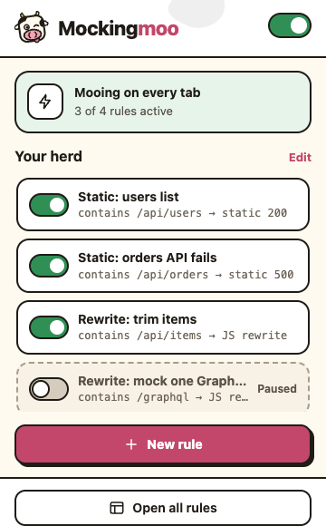
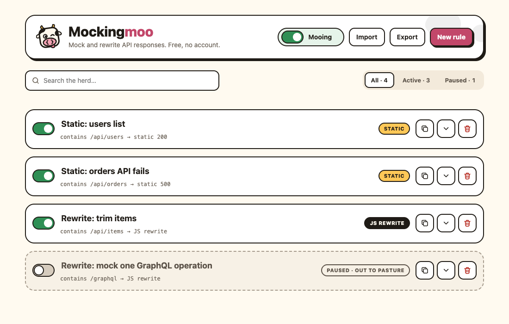
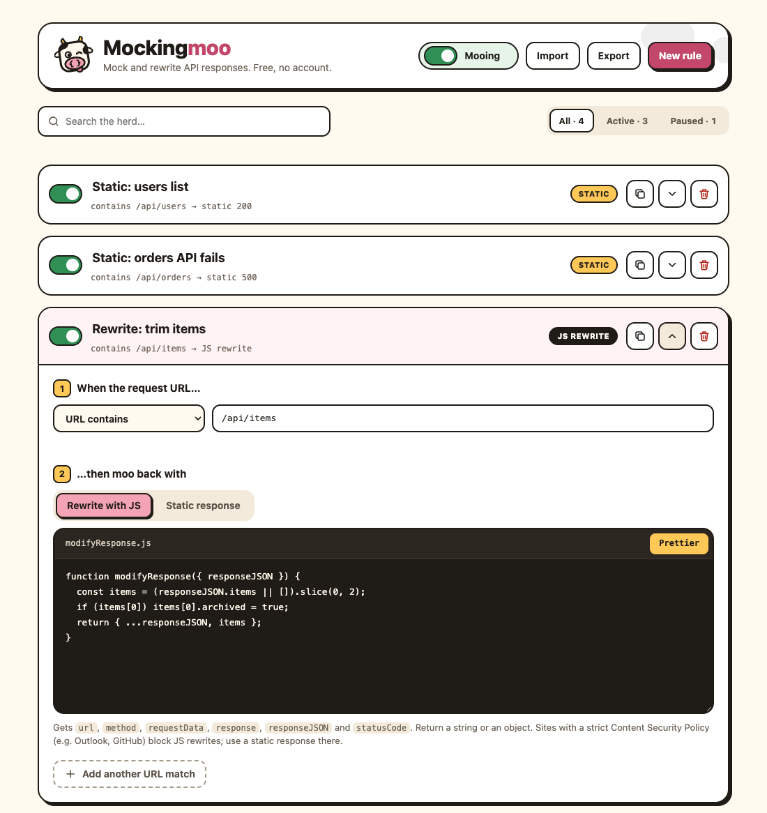

# Mockingmoo


**The API isn't ready. The cow is.**

Mockingmoo is a free, open-source Chrome extension for API mocking. It intercepts `fetch` and `XMLHttpRequest` requests by URL and lets you mock, stub or rewrite the response right in the browser, with no proxy and no change to your app's API URL. It imports Requestly "Response" rules, so it works as a drop-in Requestly alternative for response mocking.

Build the frontend before the backend exists, reproduce that 500 the on-call engineer swears never happens, or feed your UI the ugliest data you can imagine, all without touching a single server. Works with any HTTP API: REST, GraphQL, RPC, and that one endpoint nobody will admit to writing.

No account. No cloud. No telemetry. Just a cow and your browser.

## Screenshots

The toolbar popup shows the herd at a glance, with one switch to rule them all and one per cow:



The rules page is where the herd is managed: search, filter, import, export, duplicate and send to pasture:



Expand a rule to edit its URL match and response. There's a **Prettier** button, because life is too short for badly indented mocks:



## Install

1. Open `chrome://extensions` and turn on **Developer mode**.
2. Click **Load unpacked** and select this folder.
3. Pin the extension so the cow is always one click away.

After editing any extension file, click the reload icon on its card in `chrome://extensions`, then reload the page you're testing. Cows do not hot-reload.

## Quick start: mock your first API response

Five steps to your first moo:

1. Click the toolbar icon, then **Open all rules**.
2. Click **Import** and choose `examples/sample-rules.json`.
3. Switch **Static: users list** on. Imported rules always arrive napping, so you have to wake them up.
4. Check the popup says **Mooing on every tab**. If it says **Napping**, flip the big switch.
5. Open DevTools on any page and run:

   ```js
   const response = await fetch("/api/users");
   const users = await response.json();

   console.table(users.users);
   ```

   You get Ada Lovelace and Grace Hopper instead of whatever the real server had in mind, and the console confirms it:

   ```
   [Mockingmoo] applied "Static: users list" to GET https://your-site/api/users
   ```

Switch the rule off and the real responses come back. The server never knew you were gone.

## Writing your own mock rules

Click **New rule**. A rule has one or more URL matches, and each match has a URL pattern (step 1, "When the request URL…") and a response (step 2, "…then moo back with").

Every response editor has a **Prettier** button that formats the JS, or the JSON for static bodies, in place. Syntax errors show up under the editor and leave your text untouched. Prettier 3.3.3 is bundled in `vendor/prettier/`, so it works offline, on planes, and in basements.

### URL patterns: which requests to intercept

| Option | Matches when |
| --- | --- |
| URL contains | the request URL includes the text, e.g. `/api/users` |
| URL equals | the URL is exactly the text, character for character |
| URL matches regex | the URL matches the regex. Use `/pattern/i` for flags |
| URL matches wildcard | `*` stands for any text, e.g. `https://*.example.com/api/*` |

A rule with a blank pattern matches nothing. This is deliberate: a brand-new cow should not be allowed to hijack every request on the internet before you've finished typing.

### Response type 1: static mock response

Returns a fixed body and status code. Perfect for faking disasters:

- Pattern: `URL contains` `/api/orders`
- Type: `Static response`, status `500`
- Body:

  ```json
  { "error": "Internal Server Error" }
  ```

With **Skip the network** ticked (fetch only), the real request is never sent. The server stays blissfully unaware of your chaos engineering.

A static body is returned as plain text and is never executed. If you paste code into one, Mockingmoo will politely suggest you meant the other type.

### Response type 2: modify the real response with JS

For when you want the real response, just… different. Define a `modifyResponse` function. It receives the real response and returns the new body, as a string or an object:

```js
function modifyResponse({ responseJSON }) {
  // Keep only the first two items the server sent back.
  const items = (responseJSON.items || []).slice(0, 2);

  // Everything else in the payload passes through untouched.
  return {
    ...responseJSON,
    items,
  };
}
```

| Argument | Contents |
| --- | --- |
| `url`, `method` | the request URL and HTTP method |
| `requestData` | the request body: parsed if it is JSON, otherwise a string (form-encoded bodies stay a string) |
| `response` | the real response body as a string |
| `responseJSON` | `response` parsed as JSON, or `undefined` if it isn't JSON |
| `statusCode` | the real HTTP status |

Return `undefined` to leave the response alone. If the function throws, the error is logged and the real response is used, so a typo in a rule won't take the page down with it.

### Mocking one GraphQL operation among many

GraphQL and batched RPC endpoints love to funnel every operation through one URL. Look at `requestData` and only replace the call you care about:

```js
function modifyResponse({ requestData, response }) {
  // JSON request bodies arrive already parsed, so this is the GraphQL envelope.
  const isGetUser = requestData && requestData.operationName === "GetUser";

  // Not the call we care about? Hand the real response straight back.
  if (!isGetUser) {
    return response;
  }

  return {
    data: {
      user: {
        id: "1",
        name: "Mocked User",
      },
    },
  };
}
```

Several active rules can match the same URL. They run in list order, top to bottom, so each cow can handle its own operation without stepping on hooves.

## Import Requestly rules, export your own

- **Import** accepts Requestly exports (an array of `Response` rules). Rules with an `id` already in your herd are replaced, and other rule types are skipped. `examples/sample-rules.json` is a ready-made starter herd.
- **Imported rules always start paused**, whatever their `status` says in the file. A "Rewrite with JS" rule runs its code inside every page it matches, with that page's cookies and session. So read a shared file before switching its cows on. Trust, but `git diff`.
- **Export** downloads your rules in the same format, ready to share with teammates or commit alongside the project.

## Why not Requestly, Mockoon or Postman?

Those are all good tools. Mockingmoo is the small one that lives in your browser and does one job.

| | Mockingmoo | Requestly | Mockoon | Postman mock servers |
| --- | --- | --- | --- | --- |
| Where it runs | Inside the page, as a Chrome extension | Browser extension and desktop app | Local mock server (desktop app or CLI) | Postman's cloud |
| Change your app's API URL? | No | No | Yes, point your app at the mock server | Yes, point your app at the mock URL |
| Account | None | Optional, needed for sync and teams | None | Required |
| Open source | Yes, MIT | Yes | Yes, MIT | No |
| Imports Requestly rules | Yes | Native | No | No |
| What it covers | Response mocking and rewriting | Also redirects, headers, scripts, HAR recording, sessions | A full mock server: routes, latency, proxying | Mocks tied to Postman collections |

Pick Mockingmoo when you want to mock or override API responses in Chrome with zero setup, keep everything local, and stay free. Pick the others when you need request recording, header rules, team sync, or a mock that non-browser clients can hit.

## Limitations

Even the best cow has its limits.

- JS rules use `new Function`, so a page whose Content Security Policy blocks `unsafe-eval` (GitHub, Outlook, most banks) will log a warning and skip them. Static rules still work there.
- For XHR, the real request is always sent and only the response is swapped. **Skip the network** applies to `fetch` only.
- XHR responses of type `arraybuffer` or `blob` pass through untouched. The cow does not do binary.
- The extension runs on all sites and in all frames, so it patches `fetch` and `XMLHttpRequest` on every page you open, banking and webmail included. Flip it to **Napping** from the popup when you aren't mocking.
- Your rules are handed to the page so they can be applied there, which means any script on any site you visit could read them: names, URL patterns, mock bodies and rewrite code. Don't put secrets in rules, and avoid patterns that reveal internal API paths if that matters to you.
- It can't mock requests made before the page's scripts run, such as the initial HTML document. The cow has to be in the field before the request leaves the barn.

## Logo and icons

The logo is "Cheeky Moo". `icons/logo.svg` is the full-detail version and `icons/logo-small.svg` is a simplified, thicker-stroke version for small sizes. The braces in both are drawn as paths, so they don't need a font. The extension uses `icon-16/32/48.png` (rendered from the small version) and `icon-128.png` (from the full version). If you change the SVGs, re-render those PNGs at the same sizes. The cow is particular about this.

## License

[MIT](LICENSE). Prettier is bundled under its own [MIT license](vendor/prettier/LICENSE). Moo responsibly.
