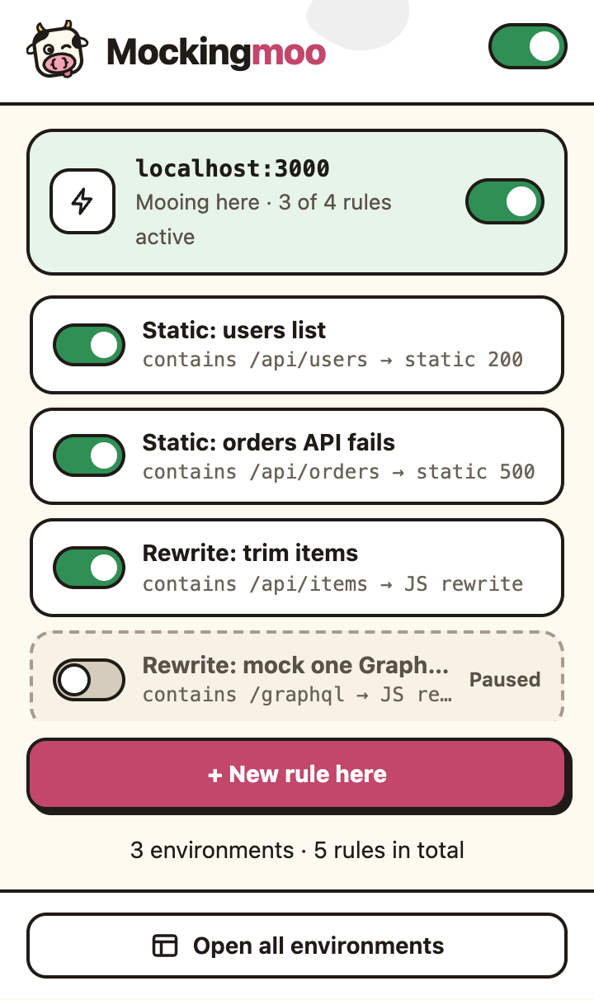
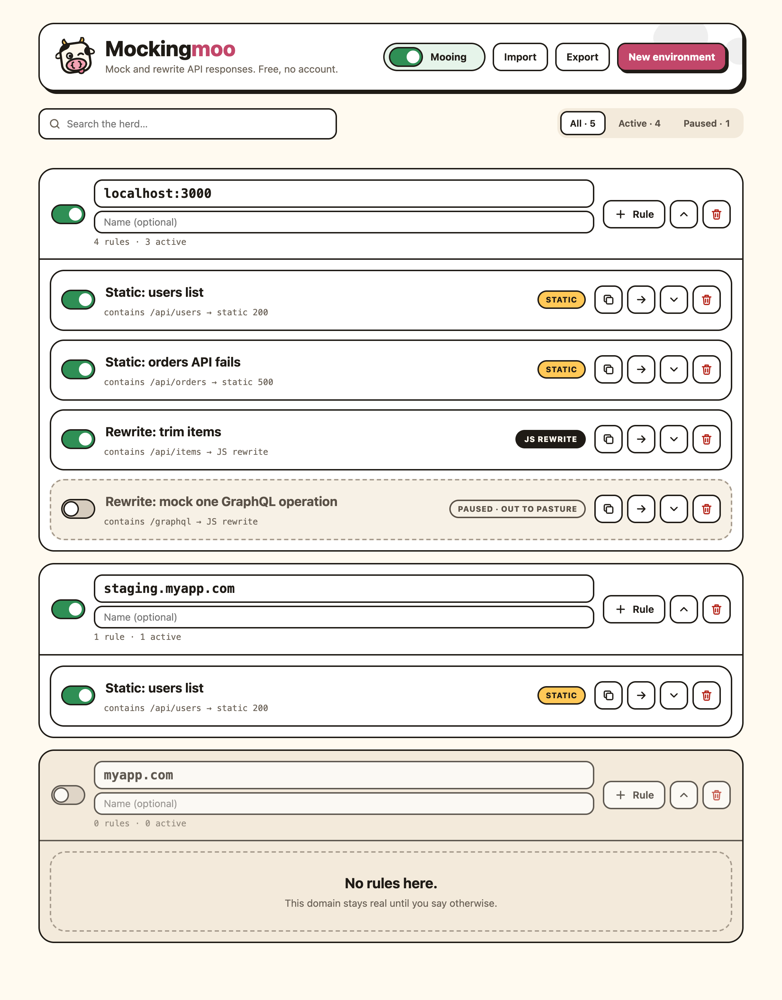
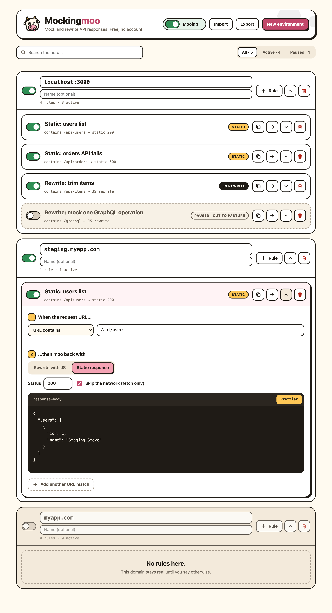

# Mockingmoo


**The API isn't ready. The cow is.**

[Website](https://tanpatrick.github.io/mockingmoo/) · [Download the latest release](https://github.com/tanpatrick/mockingmoo/releases/latest)

Mockingmoo is a free, open-source Chrome extension for API mocking. It intercepts `fetch` and `XMLHttpRequest` requests by URL and lets you mock, stub or rewrite the response right in the browser, with no proxy and no change to your app's API URL.

Build the frontend before the backend exists, reproduce that 500 the on-call engineer swears never happens, or feed your UI the ugliest data you can imagine, all without touching a single server. Works with any HTTP API: REST, GraphQL, RPC, and that one endpoint nobody will admit to writing.

No account. No cloud. No telemetry. Just a cow and your browser.

## Screenshots

The toolbar popup shows the herd for the tab you're on, with one switch to rule them all and one per cow:



The rules page is where the herd is managed, one pasture (environment) per domain: search, filter, import, export, duplicate, copy and send to pasture:



Expand a rule to edit its URL match and response. There's a **Prettier** button, because life is too short for badly indented mocks:



## Environments

Every rule lives in an environment, and every environment is fenced to one domain. Click **New environment** on the rules page (or **+ Make `<domain>` an environment** in the popup while standing on a site that doesn't have one yet), type a domain, and the cows in that pasture only ever graze there.

- **One exact domain per environment.** `hello.com` is not `www.hello.com`, so make a second environment if you want both. A domain typed without a port matches that host on any port, so `localhost` covers every dev server you own, while `localhost:3000` matches only that one. Case doesn't matter, and a pasted `https://` or trailing `/` is trimmed for you. Two environments can't claim the same domain.
- **The match is the page in the tab.** Not the host the request goes to. If the tab shows `staging.myapp.com`, every request that page makes is eligible, whichever API it calls, and so is anything framed inside it. A frame from another site on that page is still mocked by the page's environment. A page on a different site never sees the herd.
- **Parked means asleep in the barn.** An environment with a blank domain shows the badge **Parked · not applied anywhere** and mocks nothing, ever. A plain Requestly import arrives this way when you skip the domain prompt, and so does any environment that is parked inside a Mockingmoo file.
- **Three switches, all of which must be on.** The master switch (rules page header and popup), the environment's switch (its band, and its card in the popup) and the rule's own switch. If any of them is off, the cow stays put. The popup tells you which story you're in: **Mooing here · N of M rules active** or **Environment paused · nothing is mocked here**.
- **Same path, different body: Copy to…** Open a rule's tools and pick **Copy to…** to send a copy to another environment. The copy gets fresh ids, arrives paused, and only gets " (copy)" added to its name if the target already has a rule by that name. Handy for `/api/users` returning one thing on `localhost:3000` and something much worse on `staging.myapp.com`.

Each band also has a **+ Rule** button, because adding a cow where it will actually be used is just good husbandry.

## Install

1. Open `chrome://extensions` and turn on **Developer mode**.
2. Click **Load unpacked** and select this folder.
3. Pin the extension so the cow is always one click away.

After editing any extension file, click the reload icon on its card in `chrome://extensions`, then reload the page you're testing. Cows do not hot-reload.

## Quick start: mock your first API response

Six steps to your first moo:

1. Click the toolbar icon, then **Open all environments**.
2. Click **Import** and choose `examples/sample-rules.json`. The herd arrives as a parked environment called "Sample herd", which applies to no site at all until you tell it where the pasture is.
3. Type the domain of the site you'll test on into its band. For the DevTools demo below, that is the domain of whatever page you have open, such as `localhost:3000`.
4. Switch **Static: users list** on. Imported rules always arrive napping, so you have to wake them up.
5. Open the popup on that page and check it says **Mooing here**. If it says **Environment paused**, flip the environment's switch. If it says **Napping**, flip the big switch.
6. In DevTools on that same page, run:

   ```js
   const response = await fetch("/api/users");
   const users = await response.json();

   console.table(users.users);
   ```

   You get Ada Lovelace and Grace Hopper instead of whatever the real server had in mind, and the console confirms it:

   ```
   [Mockingmoo] applied "Static: users list" to GET https://your-site/api/users
   ```

Switch the rule off and the real responses come back. The server never knew you were gone.

## Writing your own mock rules

Click **+ Rule** on an environment's band (or **+ New rule here** in the popup). A rule has one or more URL matches, and each match has a URL pattern (step 1, "When the request URL…") and a response (step 2, "…then moo back with").

Every response editor has a **Prettier** button that formats the JS, or the JSON for static bodies, in place. Syntax errors show up under the editor and leave your text untouched. Prettier 3.3.3 is bundled in `vendor/prettier/`, so it works offline, on planes, and in basements.

### URL patterns: which requests to intercept

| Option | Matches when |
| --- | --- |
| URL contains | the request URL includes the text, e.g. `/api/users` |
| URL equals | the URL is exactly the text, character for character |
| URL matches regex | the URL matches the regex. Use `/pattern/i` for flags |
| URL matches wildcard | `*` stands for any text, e.g. `https://*.example.com/api/*` |

A rule with a blank pattern matches nothing. This is deliberate: a brand-new cow should not be allowed to hijack every request on the internet before you've finished typing.

### Response type 1: static mock response

Returns a fixed body and status code. Perfect for faking disasters:

- Pattern: `URL contains` `/api/orders`
- Type: `Static response`, status `500`
- Body:

  ```json
  { "error": "Internal Server Error" }
  ```

With **Skip the network** ticked (fetch only), the real request is never sent. The server stays blissfully unaware of your chaos engineering.

A static body is returned as plain text and is never executed. If you paste code into one, Mockingmoo will politely suggest you meant the other type.

### Response type 2: modify the real response with JS

For when you want the real response, just… different. Define a `modifyResponse` function. It receives the real response and returns the new body, as a string or an object:

```js
function modifyResponse({ responseJSON }) {
  // Keep only the first two items the server sent back.
  const items = (responseJSON.items || []).slice(0, 2);

  // Everything else in the payload passes through untouched.
  return {
    ...responseJSON,
    items,
  };
}
```

| Argument | Contents |
| --- | --- |
| `url`, `method` | the request URL and HTTP method |
| `requestData` | the request body: parsed if it is JSON, otherwise a string (form-encoded bodies stay a string) |
| `response` | the real response body as a string |
| `responseJSON` | `response` parsed as JSON, or `undefined` if it isn't JSON |
| `statusCode` | the real HTTP status |

Return `undefined` to leave the response alone. If the function throws, the error is logged and the real response is used, so a typo in a rule won't take the page down with it.

### Mocking one GraphQL operation among many

GraphQL and batched RPC endpoints love to funnel every operation through one URL. Look at `requestData` and only replace the call you care about:

```js
function modifyResponse({ requestData, response }) {
  // JSON request bodies arrive already parsed, so this is the GraphQL envelope.
  const isGetUser = requestData && requestData.operationName === "GetUser";

  // Not the call we care about? Hand the real response straight back.
  if (!isGetUser) {
    return response;
  }

  return {
    data: {
      user: {
        id: "1",
        name: "Mocked User",
      },
    },
  };
}
```

Several active rules can match the same URL. They run in list order, top to bottom, so each cow can handle its own operation without stepping on hooves.

## Import Requestly rules, export your own

- **Import** accepts Requestly exports (an array of `Response` rules) and Mockingmoo's own environment files. Rules with an `id` already in your herd are replaced, and other rule types are skipped. `examples/sample-rules.json` is a ready-made starter herd.
- **A plain Requestly file asks where to graze.** Requestly has no idea what a domain is, so the import prompts for one. **Import here** puts the rules in the environment for that domain (creating it if needed). **Skip, park them** drops them into a parked environment that mocks nothing until you give it a domain. A Mockingmoo file already knows its environments, so it brings them along without asking.
- **Imported rules always start paused**, whatever their `status` says in the file, and parked environments are a second, independent safety. A "Rewrite with JS" rule runs its code inside every page it matches, with that page's cookies and session. So read a shared file before switching its cows on. Trust, but `git diff`.
- **Export** downloads your environments, each with its domain, name and rules, ready to share with teammates or commit alongside the project. Each environment's `rules` array is still a valid Requestly import, so nothing stops you handing just that part to a colleague who runs the other tool.

## Limitations

Even the best cow has its limits.

- JS rules use `new Function`, so a page whose Content Security Policy blocks `unsafe-eval` (GitHub, Outlook, most banks) will log a warning and skip them. Static rules still work there.
- For XHR, the real request is always sent and only the response is swapped. **Skip the network** applies to `fetch` only.
- XHR responses of type `arraybuffer` or `blob` pass through untouched. The cow does not do binary.
- The extension runs on all sites and in all frames, so it patches `fetch` and `XMLHttpRequest` on every page you open, banking and webmail included. Flip it to **Napping** from the popup when you aren't mocking.
- The rules of the environment that matches the page are handed to that page so they can be applied there, which means any script on that page could read them: names, URL patterns, mock bodies and rewrite code. That includes cross-origin frames embedded in a matching page (ads, widgets), which also receive and can read that environment's rules. Pages that match no environment get nothing. Don't put secrets in rules, and avoid patterns that reveal internal API paths if that matters to you.
- Permissions: `storage` and `activeTab`. The latter only lets the popup see the address of the tab you clicked the icon on.
- It can't mock requests made before the page's scripts run, such as the initial HTML document. The cow has to be in the field before the request leaves the barn.

## Logo and icons

The logo is "Cheeky Moo". `icons/logo.svg` is the full-detail version and `icons/logo-small.svg` is a simplified, thicker-stroke version for small sizes. The braces in both are drawn as paths, so they don't need a font. The extension uses `icon-16/32/48.png` (rendered from the small version) and `icon-128.png` (from the full version). If you change the SVGs, re-render those PNGs at the same sizes. The cow is particular about this.

## License

[MIT](LICENSE). Prettier is bundled under its own [MIT license](vendor/prettier/LICENSE). Moo responsibly.
